# FlowAI 架构与交互机制

> 一份综合说明：前端选型、IR 数据结构、SSE 事件、生成流程（agent 循环，唯一路径）、线程模型、校验与重试、缓存与跨轮记忆。图都用 Mermaid（在 GitHub / IDE / Obsidian 里直接渲染成 SVG）；每张图下面用一两句话讲「为什么这么画」。

## 一、整体架构

### 1.1 系统架构

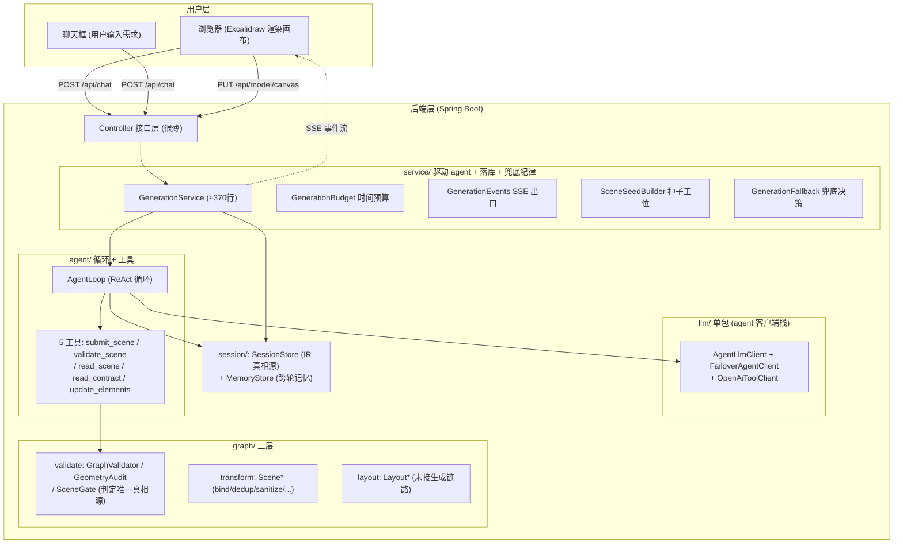

**设计思路**

- 前端只干两件事：把 IR（中间表示，即图的全部数据）画成画布、把用户操作和输入收上来；后端持有 IR、业务和 LLM 调度。两边互不关心对方内部细节，可以各改各的。
- AI 层画成「接口 + 候选链」而不是一个 `chat()` 盒子：免费模型额度/过载不稳，单家调用会让整次生成随它抖动。候选链按 tier 升序逐个试、失败冷却后切下一个，「换一家」是运行期自动行为，对业务层透明。
- **包结构按「谁改的频率不同」分层**（reorganize-harness 重组后）：`llm/` 只剩 agent 客户端栈（`AgentLlmClient` + `FailoverAgentClient` + `OpenAiToolClient`；legacy 栈随旧路径于 2026-10-15 删除），依赖方向单向 `agent→llm`（换模型厂商只动这一个包）；`graph/` 拆 validate（判定）/ transform（归一化）/ layout（排版，当前未接生成链路）三层；`service/` 的 `GenerationService` 只留编排（会话状态读取 + 终态处置 + 兜底纪律），时间预算 / SSE 出口 / 种子工位 / 兜底决策是四个伴生类（god class 1624→约 380 行）；`session/` 收拢会话存储与跨轮记忆。
- 用 SSE（服务端主动推消息）而不是等 HTTP 响应：LLM 要 30–300 秒，同步等会超时或卡住请求线程。SSE 边生成边推「思考中/校验中/结果」，前端不空屏。

### 1.2 前端为什么选 Excalidraw

FlowAI 要支持「手绘白板 + AI 改图」双通道协作：

| 方案             | 优点        | 缺点     |
| -------------- | --------- | ------ |
| React Flow     | 结构化流程图强   | 手绘能力弱  |
| **Excalidraw** | 手绘自然、可嵌组件 | 结构化编辑弱 |
| 自绘 Canvas      | 完全可控      | 开发成本高  |

选 **Excalidraw**：贴合手绘直觉，`convertToExcalidrawElements` 能把 IR 直接渲染出来。

**设计思路（渲染层的坑，后端/前端得主动兜）**

- **frame 裁剪**：跨区域的连线落在 frame 边界外的那段会被整段吃掉。兜底 `detachCrossFrameArrows`：两端归属不同 frame 的箭头清掉 `frameId` 变自由元素（不被裁），框内箭头保留 `frameId` 随框移动。
- **容器内文字双向绑定**：`bindContainerTexts` 补 `text.containerId` 的双向绑定，否则独立文字带合法 `containerId` 会静默不渲染。
- **连线几何自愈**：`healCorruptedArrows` 用边界不变量修被绑定重算污染的连线。
- **三级降级**：`convertScene` 现是「整批失败 → 剔嫌疑绑定重试 → 逐元素拼接」，保证「只要还有一个元素转得出来就绝不留空场景」。

### 1.3 前后端怎么交互

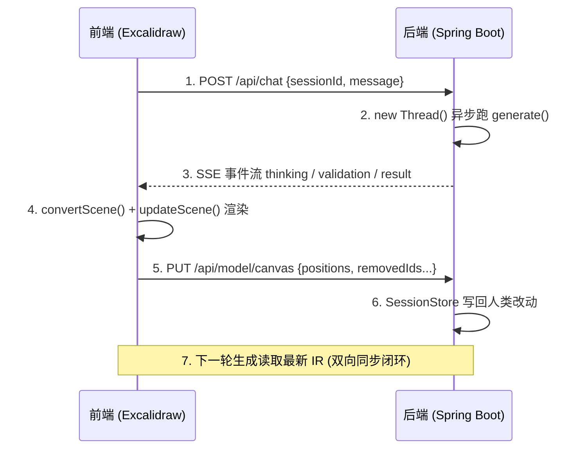

**设计思路**

- 核心闭环：AI 生成和人类拖拽都汇到**同一份 IR**。所以「AI 改图」能基于你刚拖到的位置继续画，而不是每次重画一遍把你手绘覆盖掉。第 5/6/7 步就是这个闭环的回流侧。

## 二、IR（中间表示）

### 2.1 是什么

IR 是白板内容的**唯一真相源**，包含每个元素的语义和坐标。前后端都围绕它同步。

### 2.2 元素为什么要分两层

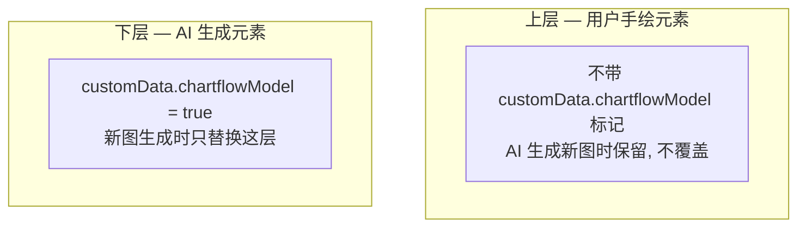

**设计思路**

- 分层不靠嵌套结构，而靠每个元素上的一个布尔标记 `customData.chartflowModel`。好处：IR 仍是 Excalidraw 那样的平铺数组，渲染零转换；区分两类元素只比一个字段。上层用户/下层 AI 的堆叠顺序，保证用户标注永远压在 AI 图之上——「白板协作」不死循环的关键（AI 重画不会吃掉你刚画的圈）。

### 2.3 IR 长什么样

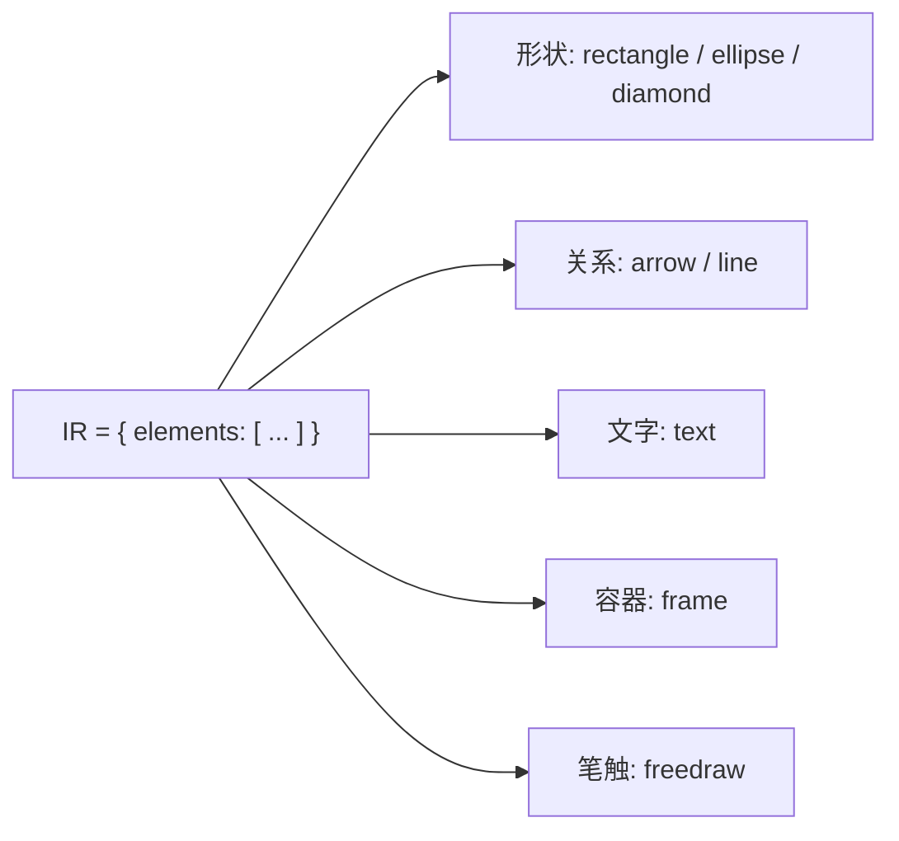

**设计思路**

- IR 是一个 `elements` 平铺数组（不是嵌套树），直接对齐 Excalidraw 的 scene，`convertToExcalidrawElements` 零结构转换就能渲染。分层/分组/画框认领都靠元素上的标记或字段表达，不靠嵌套。
- 8 类基础元素 = 流程图形（矩/椭/菱）+ 关系（箭头/直线）+ 文字 + 容器（画框）+ 手绘笔触，够表达绝大多数架构图/流程图/时序图。

### 2.4 支持的元素类型

| 类型                                    | 必填字段                                                                   |
| ------------------------------------- | ---------------------------------------------------------------------- |
| **shape** (rectangle/ellipse/diamond) | id, type, x, y, width, height                                          |
| **arrow**                             | id, type + (start.id+end.id 或 points)                                  |
| **line**                              | id, type, x, y, points                                                 |
| **text**                              | id, type, x, y, text                                                   |
| **frame**                             | id, type, x, y, width, height                                          |
| **freedraw**                          | id, type, x, y, points                                                 |
| **image**                             | id, type, x, y, width, height, fileId（前向兼容：校验器已识别，渲染层透传 fileId）        |
| **embeddable**                        | id, type, x, y, width, height, url（前向兼容；前端把 url 对齐到 Excalidraw 的 link） |
| **magicframe**                        | id, type, x, y, width, height（前向兼容；前端降级为 frame 渲染，children 仍由后端补）      |

> **契约可选字段（v2-40「契约容量」引入，全部可选，旧场景 JSON 原样可渲染）**：shape 新增 `strokeStyle`/`roundness`/`link`/`fillStyle: zigzag`；arrow 新增 `startArrowhead`/`endArrowhead`（12 种端点，含数据库鸦脚 `crowfoot_many`）/`link`；text 新增 `verticalAlign`/`autoResize`/`link`；层次：`shape.group`（模块名，后端编译为 groupIds 与 frame 成员）、`frame.children`（成员列表，由 `ScenePlanner` 计算、**不在契约里手填**）。

### 2.5 IR 存在哪

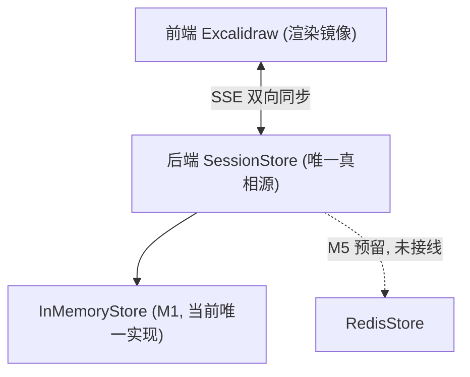

**设计思路**

- 真 IR 只在后端 SessionStore；前端只是渲染镜像。图里 InMemory / Redis 并列是「目标形态」——**当前只有 `InMemorySessionStore`（进程内内存）一个实现**；`RedisStore` 是 M5 预留依赖（引了 `spring-boot-starter-data-redis` 但没接线）。代价：单实例重启即清空会话；多实例/持久化要等 M5。

## 三、SSE 事件机制

### 3.1 有哪些事件

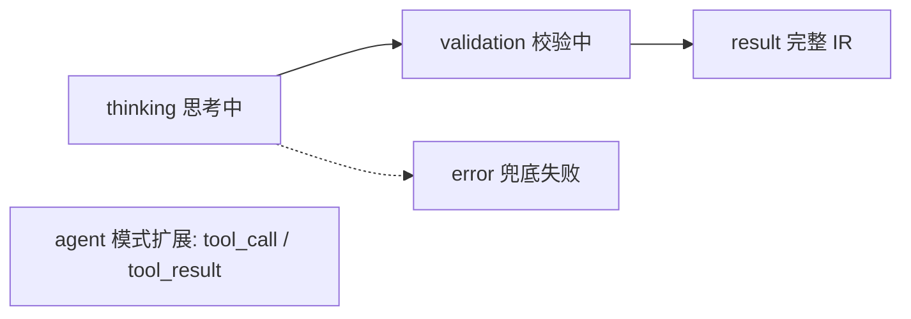

**设计思路**

- 4 类够用：`thinking` 避免空屏；`validation` 透出「在修哪几个问题」；`result` 是终态成品（完整 IR）；`error` 是兜底失败的明确信号，前端据此提示而非卡死。
- agent 循环（唯一生成路径）推 `tool_call`/`tool_result` 两类，把「模型调了哪个工具、观察结果是什么」推到前端。前端对未知类型直接忽略，旧前端不受影响。
- `update_elements`（v2-57）走 `tool_call` 通道下发增量 ops：模型只交「改了哪几个元素」，没交的原样保留——把「AI 改图 = 整图重画」这类抄丢抄错事故从机制上消灭，编辑耗时从新建的 26~~33s 降到 6~~9s。

### 3.2 场景判定管线（submit_scene 门内）

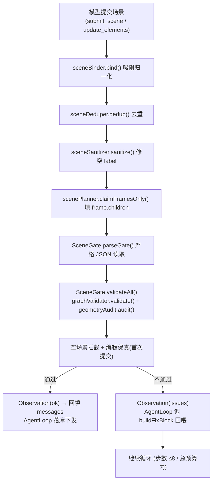

**设计思路**

- 一条链、每步只做一件事、顺序固定：`bind → dedup → sanitize → claimFramesOnly → parseGate → validate(+audit) → 空场景拦截 → 编辑保真`。`bind`/`dedup`/`sanitize` 把模型交来的半成品修成能校验的形态；`parseGate` 专拦「JSON 后多一句收尾话」这种下游会判非法的交付。整条链收在 `SceneGate`，agent 的三个提交类工具（submit_scene / update_elements / validate_scene）走同一实现。
- **agent 是唯一生成路径**（2026-10-15 起，legacy 删除）：`generate()` 直接驱动 `AgentLoopService`，没有开关、没有退路。旧 legacy 多轮修正循环（一问一答、后端拼修正 prompt）连同它的客户端栈已删——双路径对照（用户测试集电商订单 + 中台架构 / CI-CD 共 4 题实测）确认 agent 不劣化后由用户拍板收口。原来「后端轮次」的职责长在循环里：提交不过 → `buildFixBlock` 把点名化 issue 回喂 messages，模型自己决定怎么改。
- **闸门判定单一真相源**：`parseGate`/`validateAll`/`emptySceneIssue`/`detectRewrite`/`process` 都收在 `graph/validate/SceneGate`——「什么算合法」只有一份实现。

### 3.3 配置参数

| 配置                          | 值                      | 说明                                                                                             |
| --------------------------- | ---------------------- | ---------------------------------------------------------------------------------------------- |
| **TOTAL_BUDGET_MS**         | 3,600,000 ms (60分钟)    | 生成流程总时间预算（`service/GenerationBudget`；agent 循环 8 步 + 故障转移重试共用这一窗口，简单图几步达标即停）                               |
| **SSE_TIMEOUT_MS**          | 3,620,000 ms (≈60.3分钟) | SSE 连接超时 = `GenerationBudget.totalBudgetMs() + 20_000`（`DiagramController` 推导，恒与预算对齐，避免流被容器掐断） |
| **MAX_STEPS**                | 8 步                    | agent 循环步数上限（`AgentLoop.MAX_STEPS`）：容得下「读契约 → 提交 → 修正 1~2 轮」                                        |
| **单步超时**                 | 按剩余预算折算           | 每步 LLM 调用上限 = 剩余预算秒数（下限 1s），`AgentLoop.remainingSeconds` 现算，没有固定轮次概念                             |
| **TEXT_EVENT_STREAM_VALUE** | text/event-stream      | 响应媒体类型                                                                                         |

> `totalBudgetMs()` 是**方法**不是裸常量引用：`TOTAL_BUDGET_MS` 是 `static final` 字面量，别处写 `TOTAL_BUDGET_MS + 20_000L` 会被 javac 在编译期内联成字面量，出现「只改预算、对齐点没动」时增量编译不重编译对齐类、上限静默停在旧值的事故。

### 3.4 LLM 调用层（多候选故障转移）

客户端栈在 `llm/` 单包，形态是「接口 + 候选链」，应对免费模型额度/过载不稳——单家调用会让整次生成随一家厂商抖动而失败。

#### 3.4.1 组件

| 组件                                                                | 职责                                                                                                                                                                                                                                                                                                                                                                |
| ----------------------------------------------------------------- | ----------------------------------------------------------------------------------------------------------------------------------------------------------------------------------------------------------------------------------------------------------------------------------------------------------------------------------------------------------------- |
| **`AgentLlmClient` + `FailoverAgentClient` + `OpenAiToolClient`** | 唯一的客户端栈：入参是 `AgentMessages`（多轮消息单线积累），出参是 `AgentResult`（文本 + `ToolCall` 列表）。failover 语义：候选按 tier 升序全量参与、瞬时错误（502/503/504/429）对同一候选退避重试最多 3 次（2s 起翻倍）、粘性主选（记住上次成功的候选）；正式冷却/分类/多实例共享归 M13 网关。                                                                                                                                                                              |
| **`LlmProperties`**                                               | `@ConfigurationProperties(prefix="llm")`，含 `failoverEnabled` 与 `List<Candidate>`。候选字段：`tier` / `minRound` / `vision` / `largeOutput` / `maxTokens` / `timeoutSeconds` / `stream` / `idleTimeoutSeconds` / `baseUrl` / `apiKey` / `model`。                                                                                                                         |

> 早期有个 `LlmEffort`「按难度升档」路由（首轮只放便宜模型、难了再放开强模型），随 legacy 路径一同删除（2026-10-15）——现在路由就是纯按 tier 故障转移，`minRound` 字段在配置里留着但不再参与路由。  
> **故障转移状态在进程内存**（`FailoverAgentClient` 的粘性下标，单例共享、重启即忘）：多实例部署各挑各的；并发时同一候选被多线程共享重试——瞬时 502 对同一候选最多重试 3 次（退避 2s 起翻倍），重试共享同一超时窗口，不会突破总预算。


#### 3.4.2 路由规则

候选一律按 tier 升序全量参与，失败自动切下一个，**没有「按轮次/难度挑候选」的逻辑**。

> 排查「图没变化/答非所问」：先看 SSE thinking 事件「Agent 第 x/8 步」与 `[AgentFailover]` 日志行。若步数不涨、候选集合不变，则必然同模型同输出。

#### 3.4.3 配置（application.yml）

- `llm.failover-enabled: true`——关闭则退回旧单家配置（`provider`/`base-url`/`api-key`/`model`/`timeout-seconds`）。
- `chartflow.layout.engine: elk`（默认 ELK 分层竖排；`legacy` 为自研零依赖退路）。
- `chartflow.agent-loop.model: ""`（agent 候选偏好，留空 = tier 最小者；`enabled` 开关已随 legacy 删除一并移除）。
- 候选字段示例（ms-deepseek-v4.1-flash）：`tier:1, min-round:2, large-output:true, stream:true, timeout-seconds:900, idle-timeout-seconds:150, max-tokens:8192`。`max-tokens` 不设用厂商默认（往往偏小，大图被截断成半份 JSON）；设大了某些厂商返 400，需实调。
- 实测剔除清单/免费清单随厂商变动，故 `model id` 外置在 `application.yml`（不写进 Java），有每日巡检 automation 核对。

#### 3.4.4 失败语义

- **LLM 调用失败**：failover 在一步内切下一个候选（瞬时错误退避重试）；整条链都挂才抛异常，由 `generate()` 统一兜底（编辑模式还原图、新建模式给占位框或最后进度）。
- **校验失败**：不是后端轮次，而是循环内自纠——提交不过时 `AgentLoop` 调 `buildFixBlock` 把点名化 issue 回喂 messages，模型带着上下文重画；步数（8）或总预算耗尽才走兜底下发。

### 3.5 agent 模式（v2-55 循环核 + v2-57 增量编辑）

唯一生成路径：`/api/chat` 走 ReAct（推理-行动交替）循环——模型不再「一把梭交整份 JSON」，而是带着历史消息单线积累、按需调工具，由工具把每次行动的结果喂回下一步。步数上限 8，总预算 1 小时（`GenerationBudget`）。

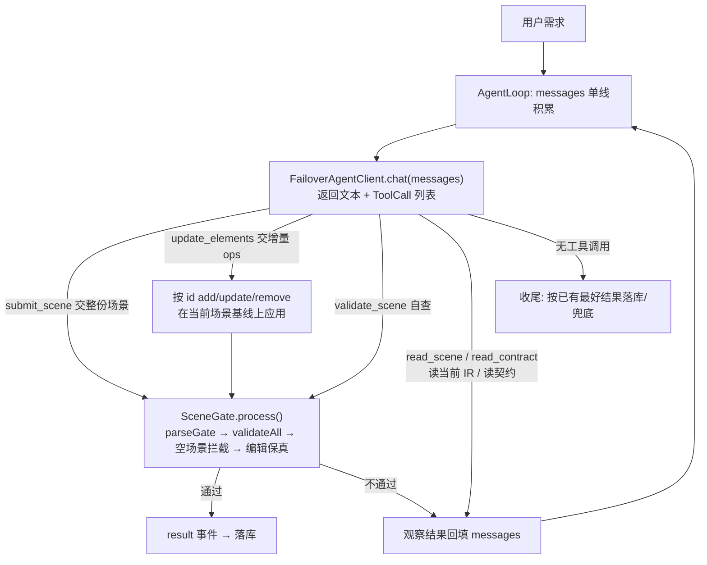

**设计思路**

- **为什么 agent 优于一把梭**：模型能先 `read_contract` 确认字段口径再画、画完 `validate_scene` 自检、错了带着 issue 上下文重画——「修哪几个问题」是模型自己看着办的，而不是后端把 issue 拼成 prompt 硬塞。
- **5 个领域工具**：`submit_scene`（交整份场景 JSON）/ `update_elements`（交增量 ops，v2-57）/ `validate_scene`（不落库的试跑校验）/ `read_scene`（读当前 IR）/ `read_contract`（读 IR schema 与规则）。全部工具的判定都走 `SceneGate.process()` 同一实现——「什么算合法」只有一份。
- **增量 ops（v2-57）**：`update_elements` 让「改一个框的颜色」不必重抄整张图，后端在当前场景基线上应用 ops 后仍走同一条 SceneGate 管线。实测编辑耗时 6~~9s，是新建（26~~33s）的 1/4~1/3。
- **遗留观察项**：① 删中间节点时模型未自动补桥接边（ops 忠实执行了删除，「删 A 补 A前→A后」的语义模型没想到）——观察项，可选提示词增量；② 时序图布局短板：消息排成平推直线、时间轴丢失（实测 my_seq 题，7 条消息箭头共线 dy=0）——根因已定位（提示词无时序图专规 + 校验器无「共线消息」判据），修复方案（提示词专规 + GeometryAudit 共线规则）待拍板。

## 四、线程模型

### 4.1 为什么另起线程

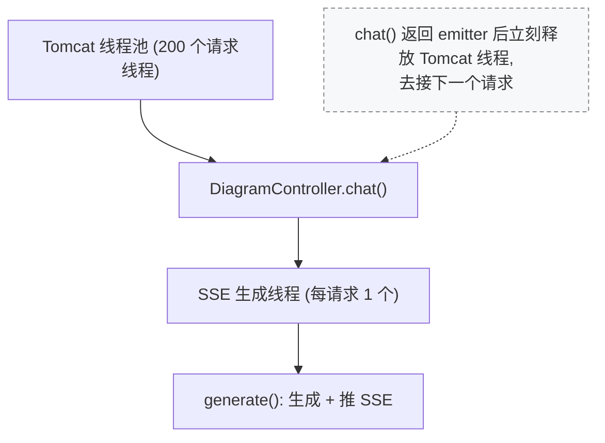

**设计思路**

- LLM 要 30–300 秒，占着 Tomcat 请求线程会很快把 200 个线程池占满、新请求排队甚至拒绝。所以每个生成请求开一个独立 SSE 生成线程跑完「生成+推 SSE」，Tomcat 线程在 `chat()` 返回 emitter 后立刻释放。线程数随并发线性增长，与 Tomcat 的 200 个请求线程互不挤占。

### 4.2 线程数量

| 场景          | Tomcat 线程 | SSE 生成线程 | 总计   |
| ----------- | --------- | -------- | ---- |
| 静态（无请求）     | 200       | 0        | ~251 |
| 3 个用户同时生成   | 200       | 3        | ~254 |
| 100 个用户同时生成 | 200       | 100      | ~351 |

## 五、校验机制（GraphValidator）

### 5.1 校验层次（由粗到细的漏斗）

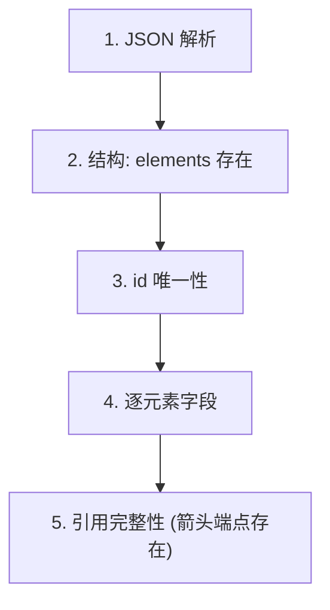

**设计思路**

- 漏斗顺序的意义：「前面的不过，后面的没意义」——读不通 JSON 就不必查 id；id 不唯一就谈不上引用谁。每失败一次尽早返回，不浪费 LLM 轮次。`parseGate`（严格 JSON）在最前、`GeometryAudit`（只量观感）在最后，两者是挂在漏斗前后的补充。

### 5.2 校验内容

- **结构**：elements 数组存在（且非空——空数组 `{elements:[]}` 单独拦截，绝不落库下发，否则前端收到 0 元素当「成功生成」）。
- **id**：唯一、格式正确。
- **type**：在 `GraphValidator.ALL_TYPES` 现含 11 种：`rectangle`/`ellipse`/`diamond`/`arrow`/`line`/`text`/`frame`/`freedraw`/`image`/`embeddable`/`magicframe`（后三者前向兼容，分别由 `validateImage`/`validateEmbeddable`/`validateMagicFrame` 处理）。
- **箭头**：`start+end` 或 `points`；不能自环（`start.id==end.id` 判非法）；`start/end` 与 `points` 可同时出现（绑定式几何由两端决定，points 仍可附带）；`line` 不能绑定到图形。
- **group 只属前三种图形**：`shape.group` 只能出现在 rectangle/ellipse/diamond 上；出现在 arrow/line/text/frame 上判非法。
- **relation**：连线语义值必须在 `RelationCatalog.ALL_RELATIONS`（10 种：`flow`/`call`/`data`/`async`/`dependency`/`one-to-one`/`one-to-many`/`many-to-many`/`inherit`/`block`），否则判非法。
- **业务（仅编辑模式第一轮）**：① 改图保真 `SceneDrift`——保留 id 但整图重排坐标判为「整图重排」；② 换图检测 `detectRewrite`——旧元素 ≥3 且 id 重叠 <30% 判为「重新画了一张图」。
- **可选枚举**（v2-40 起，硬编码集合，集合外值 → 整轮被判非法、白耗一轮重试）：`fillStyle`/`strokeStyle`/`verticalAlign`/`startArrowhead`/`endArrowhead`（12 种端点，含鸦脚 `crowfoot_one`/`crowfoot_many`）/`textAlign`/`fontFamily`/`relation`。
- **几何体检（`GeometryAudit`，在 validate 之后追加 issue）**：只测量不改坐标，把「连线交叉/穿身/标签被压」量成 issue，借修正轮让 LLM 自己重摆。阈值：`CROSSING_MIN=3` 且占比 `≥0.33`、`THROUGH_MIN=3` 且占比 `≥0.25`、`LABEL_MIN=2` 且占比 `≥0.20`。
- **解析闸门（`SceneGate.parseGate`，在校验之前）**：用 `STRICT_JSON`（开启 `FAIL_ON_TRAILING_TOKENS`）严格读一遍，读不通即转一条 issue 交修正轮，且**不记进 `lastParseable`**，堵住「坏 JSON 被记成可解析场景、兜底时下发 → 前端空白画布」的事故。
- **判定收口在 `graph/validate/SceneGate`**：`parseGate` / `validateAll` / `emptySceneIssue` / `detectRewrite` / `process`（整链）都在这一个类里。生成编排层按步委托（兜底语义留在循环侧），agent 工具整体调 `process()`——「什么算合法」只有一份实现。空场景拦截判的是**结果**不是 issue 数量（校验器自己可能漏报空数组）。

### 5.3 Issue 结构

| 字段         | 说明   | 示例                                                         |
| ---------- | ---- | ---------------------------------------------------------- |
| **field**  | 问题字段 | "elements[0].type"                                         |
| **reason** | 问题原因 | "类型不在允许范围内"                                                |
| **hint**   | 修复提示 | "type 只能是 rectangle/ellipse/diamond/arrow/line/text/frame" |

### 5.4 几何体检（GeometryAudit）

> **定位**：校验器只查「结构合法性」，不查「画得能不能看」。几何体检是补上后者的「卷尺」——**只测量、不改坐标**，把 `validate` 看不出的观感问题量成 issue，借既有修正轮让 LLM 自己重摆。

- **触发位置**：`graphValidator.validate(json)` 之后，`GenerationService` 把 `geometryAudit.audit(json)` 的结果一并 `addAll` 进 `issues`。
- **三类问题**：① 连线交叉（crossing）：两条非相邻箭头相交点 ≥`CROSSING_MIN(3)` 且占该元素连线比例 ≥`0.33`；② 穿身（through）：箭头穿过非其端点的「带标签/已绑定」图形 ≥`THROUGH_MIN(3)` 且占比 ≥`0.25`；③ 标签被压（label pressed）：某标签框与另一图形重叠 ≥`LABEL_MIN(2)` 且占比 ≥`0.20`。
- **障碍物集合** = 带 `label` 或已绑定的 shape，**减去容器（frame）**；路径复刻 `edgePointTowards` 求包围盒边缘交点；并对「inset 端点」（箭头起/终点落在图形内部）报警。
- **设计纪律**：每次最多返回 0 或 1 条 issue（避免一图几十个几何问题刷屏），且只报告不修改坐标——怎么挪由 LLM 在修正轮决定。

### 5.5 relation → 视觉样式编译（RelationCatalog）

> 合法 `relation` 值此前散落在 `GraphValidator`/`ScenePlanner`/schema 三处各抄一份，扩值易漏改导致静默不一致。现由 `RelationCatalog`（**代码唯一来源**）统管：

- `ALL_RELATIONS`：10 种合法值，与 schema 枚举、提示词三方一致。
- `STYLE`：`relation → {strokeStyle, startArrowhead, endArrowhead}` 映射，例如 `flow`/`call` = solid + triangle，`async` = dashed + triangle_outline，`data` = dotted，`one-to-many` = crowfoot_one → crowfoot_many，`inherit` = solid + triangle_outline，`block` = bar → null。
- **扩值规则（改一处不够）**：本类 `STYLE` 加一项 → `schema.arrow.relation` 加枚举 → 提示词补说明，三者必须一致（schema 与提示词仍手抄，注释统一指向本类）。

## 六、重试机制

### 6.1 处理流程

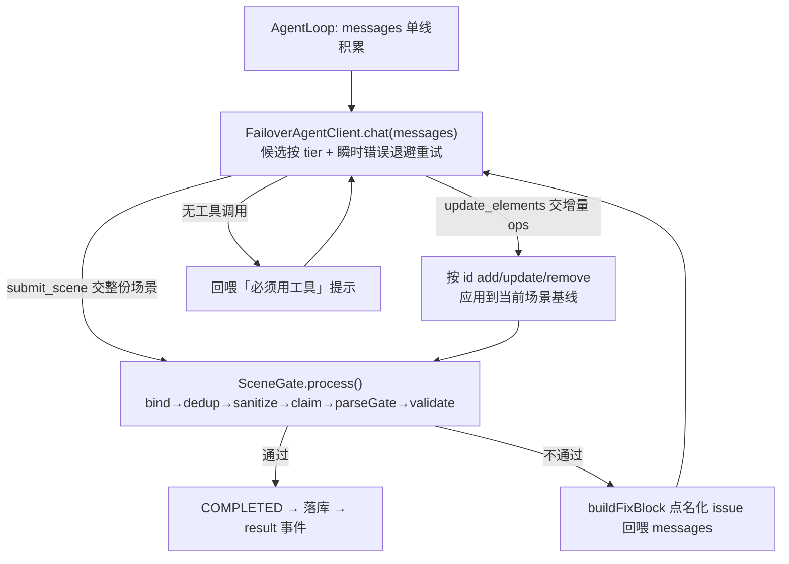

**设计思路**

- 「重试」不再是后端轮次，而是循环内自纠：提交不过 → `buildFixBlock` 把点名化 issue 回喂 messages → 模型带着自己上一轮画错的历史重画。核心纪律「**通过即发、失败才继续**」：`SceneGate.process()` 零 issue 立即 COMPLETED 落库返回；步数（8 步）或总预算耗尽才 PARTIAL 走兜底——兜底给「最后一份读得通的进度 / 原图 / 占位框」，不伪装成功。

### 6.2 重试策略

| 轮次      | 处理方式                                                                                                                                        |
| ------- | ------------------------------------------------------------------------------------------------------------------------------------------- |
| 提交未过（循环内） | `AgentLoop` 调 `buildFixBlock(submitted.issues())` 把点名化 issue 追加到 user 消息末尾，模型带着上下文重画                                        |
| 步数 / 预算耗尽   | PARTIAL：`AgentResult` 带最后一份读得通的进度，`GenerationService` 走 `GenerationFallback` 下发（编辑模式还原图、新建模式占位框），不落库 |

> **「通过即发、失败才继续」语义**：`SceneGate.process()` 零 issue 立即 COMPLETED 落库返回，绝不空转；PARTIAL 时兜底说明随 `validation` 事件如实上报（几步、为什么停），不把上一轮的图当这次成功结果。  
> **LLM 调用失败不立即兜底**：failover 在一步内切候选（瞬时错误退避重试）；整条链都挂才抛异常，由 `generate()` 统一兜底。

## 七、缓存管理（SessionStore）

### 7.1 什么情况下会触发缓存

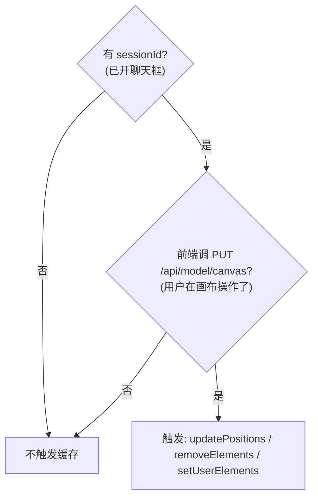

**设计思路**

- 两个条件缺一不可：`sessionId` 标识「这是哪次会话的上下文」，没有它不知存哪；`PUT /api/model/canvas` 是「人类在画布上操作了」的信号。只启动不操作、或开对话不画图，都没有需持久化的新状态，动缓存纯属浪费。和 §1.3 的双向同步闭环一致。

#### 不同场景

| 场景          | 是否触发 | 原因                   |
| ----------- | ---- | -------------------- |
| 只启动项目，没开对话  | ❌    | 没有 sessionId         |
| 开对话但不说话     | ❌    | 没有画布操作               |
| 开对话后在画布上画东西 | ✅    | 有 sessionId + 前端调用接口 |
| AI 生成后不操作画布 | ❌    | 没有用户操作               |

### 7.2 缓存作用

- AI 改图上下文 / 画布状态持久化 / 多轮对话上下文。

### 7.3 修改时机

| 操作        | 修改内容               | 方法名                              |
| --------- | ------------------ | -------------------------------- |
| AI 生成白板内容 | 覆盖整个 IR            | `sessionStore.setCurrentModel()` |
| 用户拖拽      | 更新坐标               | `sessionStore.updatePositions()` |
| 用户删除      | 移除元素               | `sessionStore.removeElements()`  |
| 用户手绘      | 存入 `_userElements` | `sessionStore.setUserElements()` |
| 用户拖动连线    | 解除绑定               | `sessionStore.releaseBindings()` |

> **画布同步请求体（`CanvasSyncRequest`）**：`PUT /api/model/canvas` 携带 `positions`（拖拽后坐标）、`removedIds`（删除的元素 id）、`userElements`（用户手绘描述）、`unboundArrows`（被解除绑定的连线几何：id/x/y/width/height/points）。`DiagramController.syncCanvas()` 依次调上面 5 个 session 方法——其中 `releaseBindings` 接收 `unboundArrows`，把用户拖出来的自由箭头几何持久化回 IR，避免「下一轮渲染又把它绑回两端图形之间、用户拖的那一下白拖」。

### 7.4 删除时机

当前实现：**只有重启服务器时才会清空**（需要优化过期机制）。

### 7.5 跨轮记忆（MemoryStore，reorganize-harness 步骤 6）

SessionStore 存「图本身」，MemoryStore 存「图的病史」——每会话累积最近 50 条校验 issue 历史（最多 1000 个会话，有界防内存泄漏）。

- **写**：agent 监听器 `onToolResult` 见到「提交未过」的 Observation 即记录（哪些字段被点名、原因是什么）。
- \*\*读（归 m5 消费）：把历史 issue 编进修正 prompt，让模型知道「这个会话反复踩过什么坑」，避免多轮细化重复踩同一 issue。
- 与 SessionStore 同生命周期（进程内存），单测 `InMemoryMemoryStoreTest` 覆盖有界淘汰与并发写。

## 八、完整交互流程

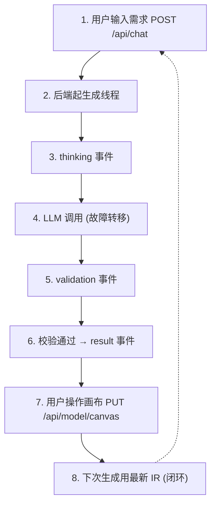

**设计思路**

- 把前面所有图串成一条端到端闭环：需求 → 生成线程 → thinking → LLM（故障转移）→ validation → result → 用户操作回流 → 下次用最新 IR。
- 产品核心卖点藏在 ⑦⑧：你在画布上拖了一下，这下操作经 `PUT /api/model/canvas` 写回 IR，下一轮 AI 读到的就是「带你最新位置」的 IR。所以「白板 AI 协作」不是两次独立生成，而是同一份 IR 上人类与 AI 轮流改。

## 九、关键概念

### 9.1 sessionId 和 message

| 概念            | 定义          | 作用                   |
| ------------- | ----------- | -------------------- |
| **sessionId** | 会话 ID（UUID） | 关联当前图模型，区分不同会话       |
| **message**   | 用户输入的消息     | 作为 prompt 的一部分传给 LLM |

### 9.2 数据流总结

```
用户需求 → LLM 生成 → 校验 → 保存 → 推送 → 渲染 → 操作 → 更新
```

### 9.3 设计原则

1. **IR 唯一真相源**：后端持有，前端只持渲染镜像。
2. **双向同步**：AI 改图和人类拖拽都汇到同一份 IR。
3. **校验优先**：坏数据不到前端（含 `parseGate` 严格 JSON 关 + `GeometryAudit` 几何体检）。
4. **自纠循环**：agent 循环内「提交不过 → 点名化 issue 回喂 → 重画」，步数上限 8 + 总预算 1 小时；通过即发、失败才继续。
5. **异步处理**：避免阻塞，提高响应性。
6. **元素分层**：用户手绘在上层，AI 生成在下层，防止覆盖。
7. **多候选故障转移**：免费模型不稳，靠 `FailoverAgentClient` 候选链 + 瞬时错误退避重试 + 粘性主选保障可用性（见 §3.4）。

## 十、调试建议

- **看 SSE 事件**：浏览器开发者工具 → Network → /api/chat → EventStream。
- **看 IR 数据**：后端断点 `GenerationService.saveModel()`。
- **看校验结果**：断点 `graph/validate/SceneGate.process()`（5 个工具共用同一判定）+ `agent/AgentLoop` 循环体。
- **看 LLM 候选切换**：failover 明细看 `FailoverAgentClient` 的 `[AgentFailover]` 行（命中/失败/重试）；循环进度看 SSE thinking 事件「Agent 第 x/8 步」。
- **看元素标记**：前端控制台检查元素的 `customData.chartflowModel` 属性。
